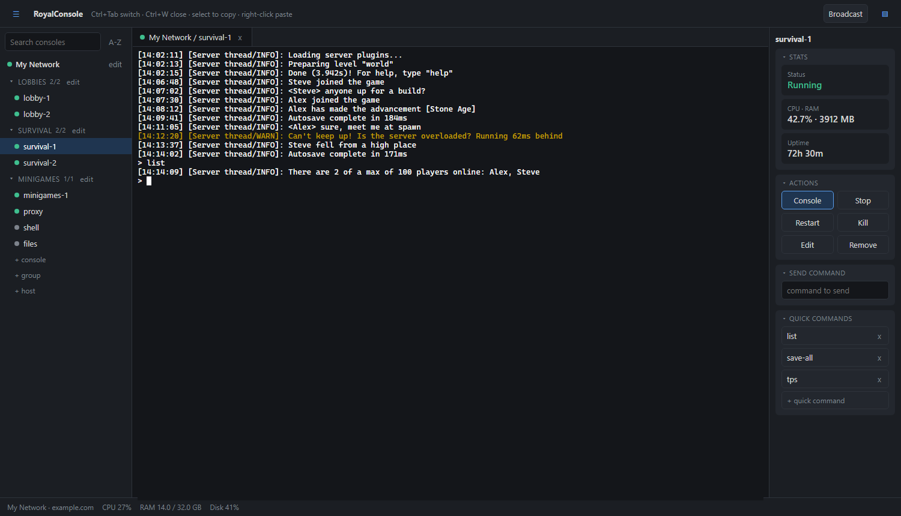

# RoyalConsole

SSH console and server monitor for Windows. Every server runs in a tmux session on its host; RoyalConsole lists them, attaches to their consoles in tabs, and shows CPU, RAM and uptime.



*The screenshot uses sample data.*

```
npm install
npm start
npm run dist   # dist/RoyalConsole-Setup-*.exe
```

Hosts are saved in `%APPDATA%/royalconsole/hosts.json`. Key login only (default `~/.ssh/id_ed25519`).

Releases: bump `version` in `package.json` and push to main, then run the **Release** workflow from the Actions tab (or push a matching `v*` tag). It builds the installer, creates the tag and publishes the release.
